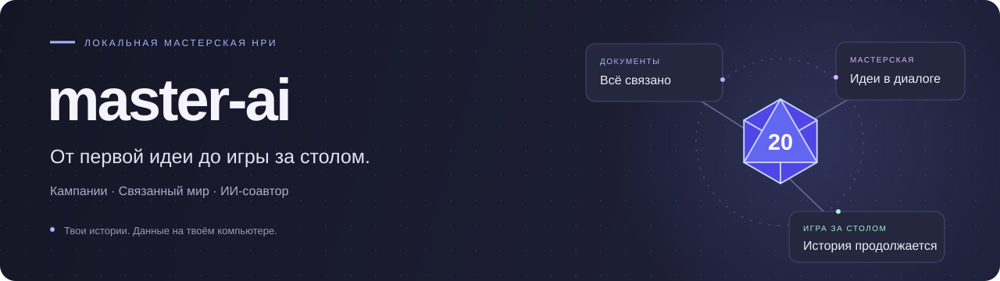
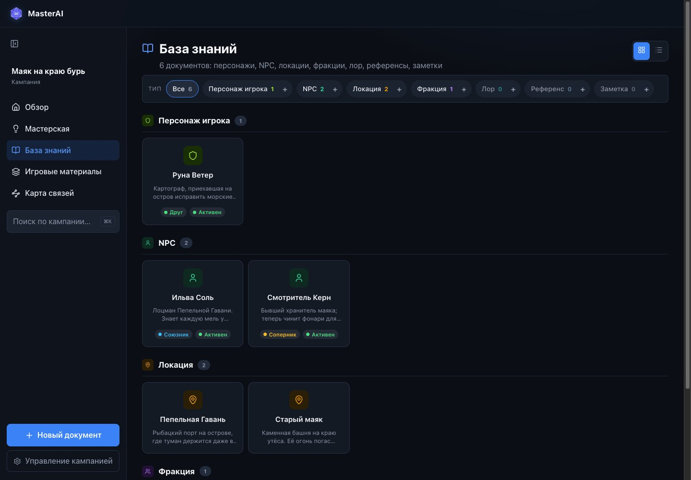
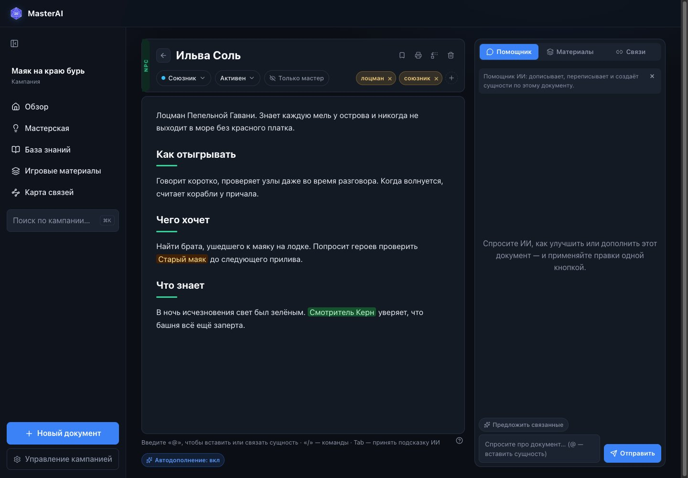
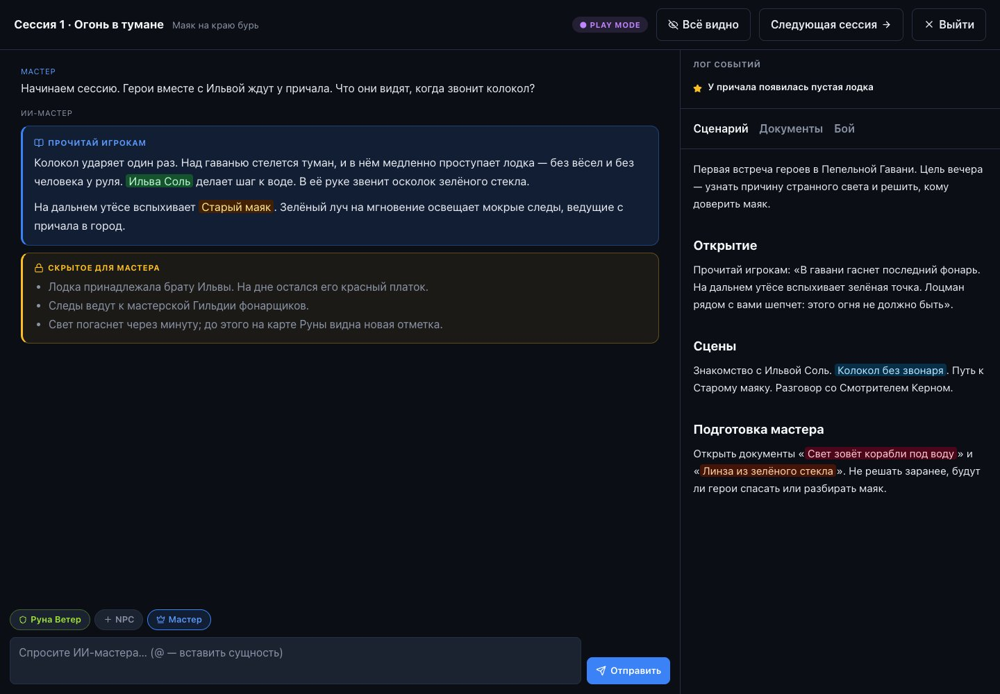

<p align="center">
  
</p>

<p align="center">
  <strong>Prepare and run tabletop RPG campaigns with AI.</strong><br>
  A connected world notebook, an idea workshop, and a session workspace.
</p>

<p align="center">
  <a href="https://github.com/andrewpiskunov/master-ai/actions/workflows/ci.yml"></a>
  <a href="LICENSE"></a>
  <a href=".nvmrc"></a>
  <a href="README.md">Русский</a>
</p>

master-ai helps game masters turn ideas into playable campaigns: write characters and locations, connect them, discuss scenes with an AI assistant, and keep your notes open during play. Review AI proposals before adding them to your world.

Campaigns live in a local SQLite database. AI requests use an installed CLI or an OpenAI-compatible API. Context is sent to the selected provider when you request a generation. **The application UI, templates, and detailed guides are currently in Russian.**



## Features

| Preparation | During play |
| --- | --- |
| 13 document types, including characters, locations, scenes and secrets | Session workspace with AI game-master chat and an event log |
| TipTap editor with AI suggestions | Scenario and reference documents beside the chat |
| Workshop conversations and reviewable drafts | Player characters, NPCs and a combat tracker |
| Full-text search, mentions and a document relationship map | Player-facing text and private GM notes |
| Campaign import/export as JSON | Print views and session progression |

Full database backups and token statistics are also available. CLI token counts are estimates; API usage is used when the provider returns it.

<details>
<summary>More screenshots</summary>





</details>

## Quick start

Use **Node.js 22.9+ on the 22.x release line** and **pnpm 9.15.9**. [.nvmrc](.nvmrc) pins the tested version; with nvm, run `nvm install` and `nvm use` after cloning.

```bash
git clone https://github.com/andrewpiskunov/master-ai.git
cd master-ai
corepack enable
corepack prepare pnpm@9.15.9 --activate
pnpm install --frozen-lockfile
cp .env.example .env
pnpm dev
```

Open **[localhost:5173](http://localhost:5173)**. The API listens on `127.0.0.1:5174`; database setup and migrations run at server startup. PowerShell users can use `Copy-Item .env.example .env`.

### Try the demo

With the app running, open another terminal at the repository root:

```bash
pnpm demo:import
```

This imports a fictional coastal mystery with 10 documents and 12 links. Each import creates a separate campaign. Browsing and editing it needs no AI account. See [the example guide](examples/README.md).

### Configure AI

- **CLI:** the default command is `claude -p`. Install and authenticate it separately, or set another command and arguments in the root `.env` file.
- **API:** open campaign settings, select the OpenAI-compatible provider, and enter a key, model and optional base URL.

See [configuration](docs/configuration.md) for the exact settings and fallback behavior.

## Data and current scope

master-ai is a **single-user localhost application**. It currently has no authentication or multi-user mode. The documented workflow runs locally.

- Database: `packages/server/data/master-ai.sqlite`.
- Backups: `packages/server/data/backups/`; startup backup rotation keeps up to 7 dated copies.
- Campaign JSON export removes the configured API key. Full SQLite backups include credentials and should remain private.

Read [backup and update instructions](docs/backup-and-updates.md) before installing a version that changes the database.

## Repository

| Package | Responsibility |
| --- | --- |
| [web](packages/web/README.md) | React/Vite UI, campaign features, TipTap editor and play workspace |
| [server](packages/server/README.md) | Fastify routes, services, SQLite/Drizzle and AI adapters |
| [shared](packages/shared/README.md) | TypeScript/Zod contracts, document registries and game text utilities |

Guides live in [docs](docs/README.md), importable content in [examples](examples/README.md), and repository checks in `scripts/`.

## Development

```bash
pnpm test        # All tests; no real AI requests
pnpm typecheck   # Type-check all packages
pnpm build       # Build the production web bundle
pnpm docs:check  # Check local documentation links and the demo import cycle
pnpm check       # Run all checks above
```

The backend runs through tsx; separate production backend packaging is not configured yet. See [development](docs/development.md) and [architecture](docs/architecture.md).

Bug reports and ideas are welcome through [Issues](https://github.com/andrewpiskunov/master-ai/issues/new/choose). Read [CONTRIBUTING.md](CONTRIBUTING.md) before submitting a PR. See the [roadmap](docs/roadmap.md), [changelog](CHANGELOG.md), and [security policy](SECURITY.md).

The README uses patterns from Excalidraw, Immich and Paperless-ngx; [comparison and sources](docs/readme-references.md). Released under the [MIT license](LICENSE).
