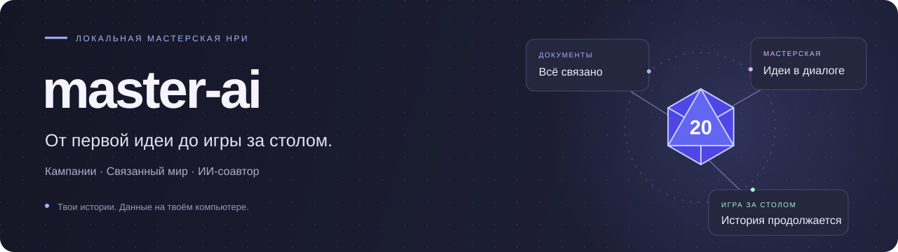
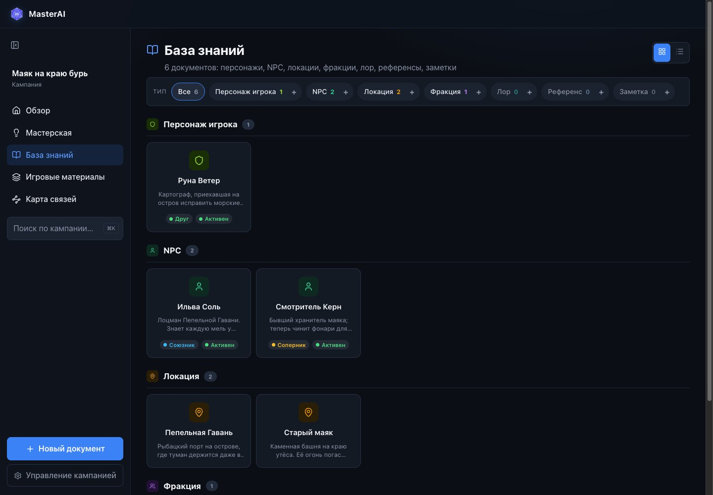
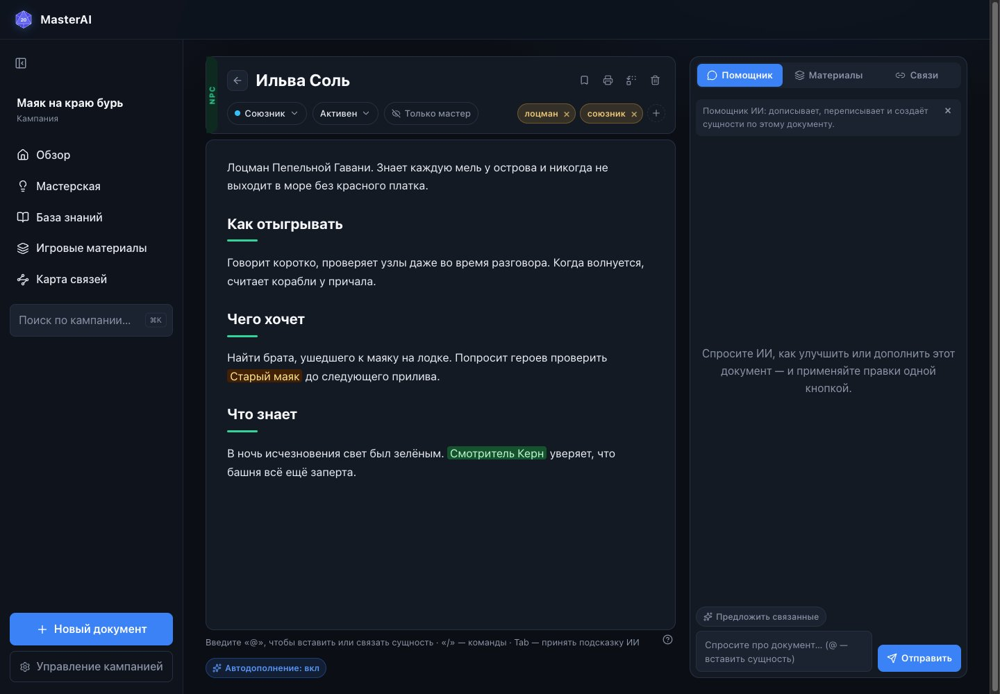
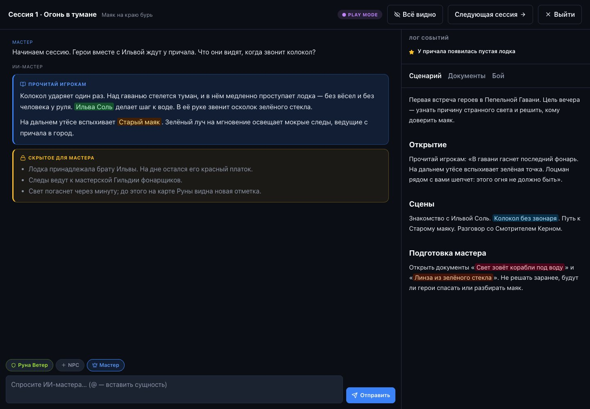

<p align="center">
  
</p>

<p align="center">
  <strong>Подготовка и ведение настольных ролевых игр с ИИ.</strong><br>
  Документы мира, мастерская идей и игровой стол в одном приложении.
</p>

<p align="center">
  <a href="https://github.com/andrewpiskunov/master-ai/actions/workflows/ci.yml"></a>
  <a href="LICENSE"></a>
  <a href=".nvmrc"></a>
  <a href="README.en.md"></a>
</p>

<p align="center">
  <a href="#быстрый-старт">Быстрый старт</a> ·
  <a href="#что-умеет">Возможности</a> ·
  <a href="examples/README.md">Демо-кампания</a> ·
  <a href="docs/README.md">Документация</a> ·
  <a href="CONTRIBUTING.md">Участие в разработке</a>
</p>

master-ai помогает собрать кампанию из разрозненных идей: описать персонажей и места, связать их между собой, обсудить завязку с ИИ и открыть подготовленные материалы во время игры. Предложения ассистента можно проверить перед добавлением в базу мира.

Кампании хранятся в SQLite на твоём компьютере. Для ИИ используется установленный локально CLI или OpenAI-совместимый API; при генерации контекст передаётся выбранному провайдеру.



## Что умеет

| Во время подготовки | За игровым столом |
| --- | --- |
| Кампании с собственной базой мира | Сессия с чатом ИИ-мастера и журналом событий |
| 13 типов документов: персонажи, локации, сцены, секреты и другие | Сценарий и нужные документы рядом с чатом |
| Редактор на TipTap с предложениями ИИ | Персонажи игроков, NPC и трекер боя |
| Мастерская: обсуждение идей и подтверждение черновиков | Разделение текста для игроков и заметок мастера |
| Поиск, упоминания, связи и карта документов | Материалы для печати и переход к следующей сессии |

Есть экспорт и импорт кампаний в JSON, полная копия базы и статистика токенов. Для CLI расход оценивается по длине текста; API-провайдер использует переданную моделью статистику, когда она доступна.

<details>
<summary>Ещё скриншоты: редактор и игровой режим</summary>

### Документ кампании



### Игра за столом



</details>

## Быстрый старт

Нужны **Node.js 22.9+ в ветке 22** и **pnpm 9.15.9**. Версия для воспроизводимой установки записана в [.nvmrc](.nvmrc). Если используешь nvm, выполни `nvm install` и `nvm use` после клонирования.

```bash
git clone https://github.com/andrewpiskunov/master-ai.git
cd master-ai
corepack enable
corepack prepare pnpm@9.15.9 --activate
pnpm install --frozen-lockfile
cp .env.example .env
pnpm dev
```

Открой **[localhost:5173](http://localhost:5173)**. API работает на `127.0.0.1:5174`; база и миграции создаются при первом запуске. В PowerShell вместо `cp` можно использовать `Copy-Item .env.example .env`.

### Посмотреть готовую кампанию

Пока приложение запущено, открой второй терминал в корне репозитория:

```bash
pnpm demo:import
```

Команда добавит [«Маяк на краю бурь»](examples/README.md): 10 документов, связанные персонажи и места, завязка первой сессии. Каждый импорт создаёт отдельную кампанию. Для просмотра и редактирования нейросеть не нужна.

### Подключить ИИ

- **CLI:** по умолчанию запускается `claude -p`. CLI нужно отдельно установить и авторизовать; команду и аргументы можно изменить в `.env`.
- **API:** в разделе «Управление кампанией» выбери OpenAI-совместимый API, укажи ключ, модель и при необходимости базовый URL.

Точные настройки и поведение при отсутствии ключа описаны в [руководстве по конфигурации](docs/configuration.md).

## Данные и ограничения

Приложение рассчитано на **одного пользователя на локальном компьютере**. Авторизации и многопользовательского режима пока нет; инструкции описывают запуск на localhost. Интерфейс и шаблоны документов — на русском языке.

- Рабочая база: `packages/server/data/master-ai.sqlite`.
- Резервные копии: `packages/server/data/backups/`; при стартах сервера сохраняются последние 7 дневных копий.
- JSON-экспорт кампании исключает настроенный API-ключ. Полная SQLite-копия содержит все настройки — храни её как личные данные.

См. [резервное копирование и обновление](docs/backup-and-updates.md), включая копию **до** запуска новой версии с миграциями.

## Устройство репозитория

```text
master-ai/
├── packages/
│   ├── web/          # React: кампании, документы, ассистент и игровой стол
│   ├── server/       # Fastify: HTTP-маршруты, сервисы, SQLite и ИИ-провайдеры
│   └── shared/       # Общие схемы, реестры документов и разбор игрового текста
├── docs/             # Руководства, архитектура, roadmap и иллюстрации
├── examples/         # Вымышленная кампания в формате импорта
├── scripts/          # Проверки документации и работа с примером
└── .github/          # CI, обновления зависимостей и шаблоны обращений
```

| Пакет | Назначение |
| --- | --- |
| [web](packages/web/README.md) | React, Vite, TipTap и пользовательские сценарии |
| [server](packages/server/README.md) | Fastify API, Drizzle, SQLite FTS5 и адаптеры ИИ |
| [shared](packages/shared/README.md) | Контракты TypeScript и Zod без привязки к UI и серверу |

## Разработка

```bash
pnpm test        # Все тесты; реальные ИИ-запросы не выполняются
pnpm typecheck   # Проверка типов трёх пакетов
pnpm build       # Production-сборка веб-клиента
pnpm docs:check  # Локальные ссылки и полный цикл импорта примера
pnpm check       # Все перечисленные проверки
```

Backend запускается через tsx; отдельная production-упаковка сервера пока не настроена. Подробности — в [руководстве разработчика](docs/development.md) и [описании архитектуры](docs/architecture.md).

## Помочь проекту

Ошибки и предложения можно оформить через [Issues](https://github.com/andrewpiskunov/master-ai/issues/new/choose). Перед первым PR прочитай [CONTRIBUTING.md](CONTRIBUTING.md); планы развития собраны в [roadmap](docs/roadmap.md), изменения — в [changelog](CHANGELOG.md). Для сообщений об уязвимостях есть [отдельный порядок](SECURITY.md).

Оформление README опирается на приёмы Excalidraw, Immich и Paperless-ngx: [сравнение и источники](docs/readme-references.md).

Код распространяется под [лицензией MIT](LICENSE).
