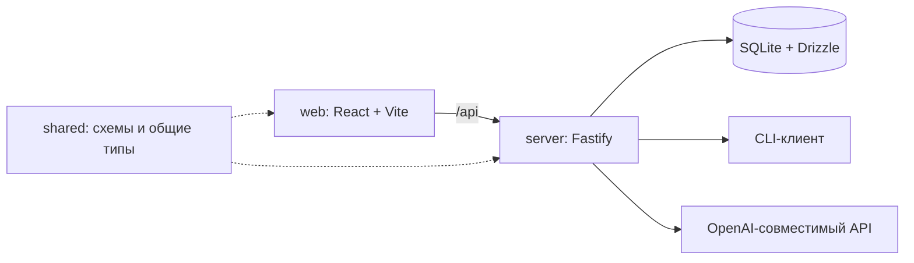

# Архитектура

master-ai состоит из трёх workspace-пакетов. Браузер общается с локальным API, API работает с SQLite и выбранным провайдером ИИ.

## Границы пакетов

| Пакет | Ответственность |
| --- | --- |
| `@master-ai/web` | React-интерфейс, маршруты, редактор Tiptap, режим игры и взаимодействие с API. |
| `@master-ai/server` | Fastify-маршруты, проверка входных данных, сервисы, SQLite и запросы к ИИ. |
| `@master-ai/shared` | Zod-схемы, TypeScript-типы, реестры документов и общие функции. |

В сервере `app.ts` собирает приложение, `routes` регистрирует HTTP-маршруты, `services` выполняет операции с данными. `db` отвечает за подключение и описание таблиц, `llm` — за провайдеров. `main.ts` открывает рабочую базу и запускает сервер.

В интерфейсе `app` связывает маршрутизацию и общую оболочку. Функциональные экраны собраны в `features`; общие компоненты, HTTP-клиент, функции и хуки лежат в `ui`, `api`, `lib` и `hooks`.

Другие пакеты используют shared через его публичный `index.ts`. Перенос файла внутри shared не должен менять доступные импорты `@master-ai/shared`.

## Модель данных

Кампания объединяет документы, беседы, предложения ИИ, связи и статистику запросов. Документ хранит тип, заголовок, статус, содержимое ProseMirror и поля своего типа.

Беседа принадлежит кампании и может быть привязана к документу. Сообщения хранят текст и метаданные; игровой чат использует их для действий и журнала событий. Предложения ИИ хранятся отдельно и имеют статус принятия. Связи соединяют документы одной кампании.

Drizzle описывает таблицы и применяет SQL-миграции. SQLite работает в режиме WAL. Поиск использует FTS-индекс; сервер перестраивает его при запуске. База и резервные копии лежат в `packages/server/data` при запуске штатными workspace-командами.

Оригиналы изображений хранятся в SQLite. Для интерфейса сервер по запросу создаёт WebP-превью с максимальной стороной 128, 256, 512 или 1024 пикселя и сохраняет их в отдельном кэше. Повторные запросы читают готовую копию без декодирования оригинала. Превью не входят в JSON-экспорт кампании и пересоздаются после импорта; удаление исходного изображения удаляет и его кэш.

## Запрос к ИИ

Сервер собирает запрос из сообщения и контекста кампании или документа. Провайдер возвращает поток текста; интерфейс показывает ответ по мере поступления. Сервисы сохраняют беседы и предложения, а статистика учитывает запросы, токены и длительность.

Мастерская хранит историю целиком. Пустое служебное сообщение с метаданными `workshopTopicStart: true` отмечает начало новой темы. Модель и сводка мира получают только сообщения после последней такой границы, включая только вложения текущей темы. Граница сохраняется при экспорте и импорте.

Перед каждым запросом мастерской сервер заново читает документы текущей кампании и передаёт их тексты, статусы и дополнительные поля. Непринятые предложения идут отдельным списком черновиков: они доступны для обсуждения, но ещё не считаются документами кампании. Принятые и отклонённые версии предложений в этот список не входят; после принятия используется актуальный документ с правками мастера.

Игровой чат также получает свежие тексты, ID, статусы и поля карточек своей кампании вместе с брифом. Правки передаются блоками `edit-doc`, а интерфейс открывает сравнение с последней сохранённой версией. Условный PATCH с `expectedUpdatedAt` отклоняет устаревшую запись кодом 409; после конфликта мастер видит обновлённое сравнение.

Общий бюджет содержимого документов и черновиков — 180 000 символов, отдельно от брифа, шаблонов и истории беседы. Пока материалы помещаются в бюджет, их тексты передаются целиком. Для больших кампаний сначала загружаются материалы, явно названные в запросе; оставшийся бюджет распределяется между остальными. Сокращённые источники получают `contentTruncated: true`. Инструкция запрещает предлагать полную замену документа по такому отрывку и предлагает уточнить запрос по названию карточки.

По умолчанию используется внешний CLI-процесс. Для кампании с провайдером `openai` и непустым ключом сервер обращается к OpenAI-совместимому Chat Completions API. С пустым ключом используется CLI. Токены CLI оцениваются по длине текста; API может вернуть точный usage, иначе применяется оценка.

ИИ-клиент не входит в состав репозитория. Его установка и авторизация выполняются отдельно. Детали выбора провайдера: [настройка](configuration.md).

## Перенос и границы запуска

JSON-экспорт переносит одну кампанию и её содержимое. Импорт генерирует новые идентификаторы и связывает записи заново. Полная SQLite-копия сохраняет всю базу. Эти способы и порядок восстановления описаны в [руководстве по данным](backup-and-updates.md).

В приложении нет авторизации и многопользовательских прав. Поддерживаемый сценарий — один пользователь на своей машине; сетевые ограничения описаны в [SECURITY.md](../SECURITY.md).
